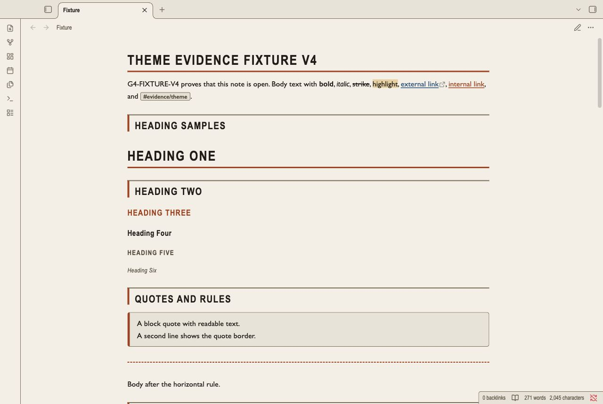
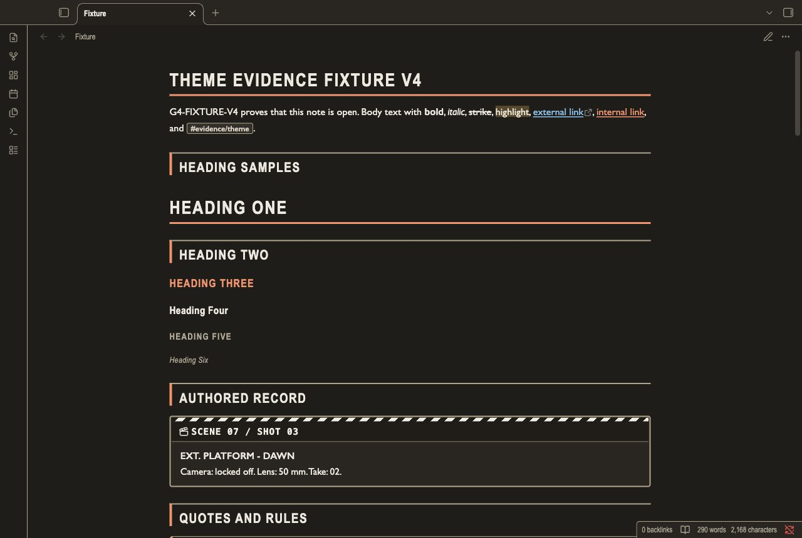
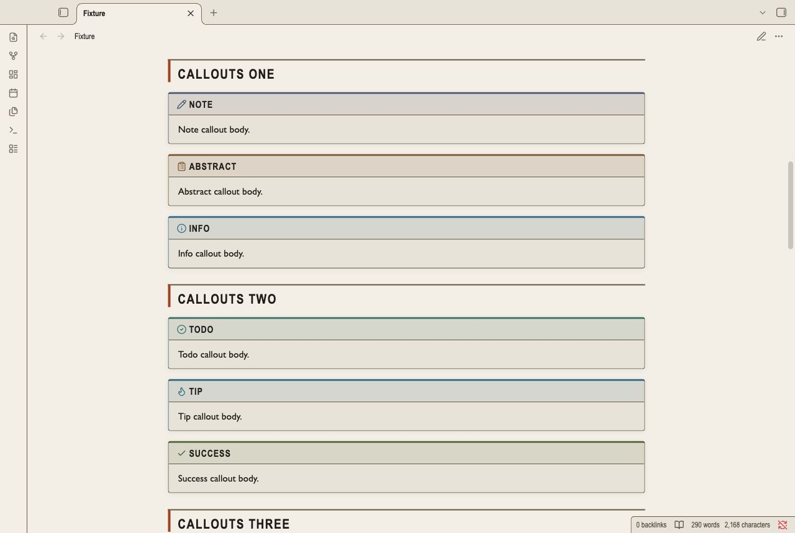
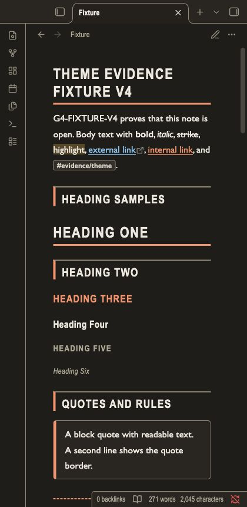

# Storyboard Frames

Storyboard Frames is for scene outlines, sequence notes, and shot lists.
Warm board paper and charcoal panels give each section a clear edge.
Condensed titles, shot cards, and dashed cut lines make long sequences easier to scan.
The theme changes presentation. It does not generate scene numbers.

## Screenshots

These captures show the last tested revision in the Obsidian desktop renderer.
The current R2 styles await a new native capture.
The narrow capture is a desktop viewport. It is not a mobile device test.






## Install

1. Download `theme.css` and `manifest.json` from this repository.
2. Open your vault folder.
3. Create `.obsidian/themes/Storyboard Frames/` in that folder.
4. Copy both files into `Storyboard Frames`.
5. Open Settings in Obsidian.
6. Open Appearance.
7. Select **Storyboard Frames** in the theme list.

Use the manifest name for the installed folder.
The repository folder name is a GitHub slug.

## Uninstall

1. Open Settings.
2. Open Appearance.
3. Select the default theme.
4. Remove `.obsidian/themes/Storyboard Frames/` from your vault.

Your note files remain in the vault.

## Content styles

H1 has a title rule. H2 has a frame edge.
H3 uses the scene accent. H4 uses a mixed-case condensed label.
H5 uses smaller uppercase text. H6 uses smaller mixed-case italic text.
Callouts use a title strip above their content.
A colored top edge, type icon, and label identify the callout type.
Tables use bordered cells and alternate row surfaces.
Nested lists use guide lines. Ordered lists use leading-zero markers in Reading view.
Completed tasks use a checkmark and muted text.
An unfinished nested task keeps its normal text color.
Code and embeds use bordered panels. Inline code uses a small shaded label.
Quotes use an accent edge. Tags use compact labels.
Links have underlines. Unresolved links also use a heavier weight.
Horizontal rules use a dashed cut line.

## Authored scene slates

Use a `scene` callout for a scene and shot record.
Type the scene and shot identifiers in the title. They stay in your note.
The striped slate header does not generate numbers.

```markdown
> [!scene] SCENE 07 / SHOT 03
> **EXT. PLATFORM - DAWN**
> Camera: locked off. Lens: 50 mm. Take: 02.
```

The slate has styles for Reading view and Live Preview.
Native verification of this revision is pending.

## Compatibility

The manifest keeps Obsidian 1.5.0 as the minimum version.
The G4 evidence uses the Obsidian 1.14.4 desktop renderer.
Reading view and Live Preview are tested in light and dark modes.
Mobile is not tested.
Community plugin layouts are not tested.

## Customization

Add a CSS snippet in your vault to change the frame size and spacing:

```css
.theme-light, .theme-dark {
  --file-line-width: 46rem;
  --line-height-normal: 1.7;
  --callout-radius: 2px;
}
```

Use the Obsidian Accent color setting for selected settings rows, checked controls, and sliders.
The theme bounds accent lightness to keep white labels readable in light mode and dark labels readable in dark mode.
The selected hue remains visible.
Set `--frame-accent` in each mode to change frame edges and list markers.
Set `--frame-card` to change card surfaces.
Set `--frame-line` to change structural borders.
Check contrast after you change a color.
Style Settings is not required. This theme has no Style Settings panel.
Fonts come from the local system. No font or image is loaded from a network.

## Known limits

- Type stable scene numbers in Markdown. Automatic heading counters remain disabled because long-note rendering can reset them.
- Reading view uses leading-zero ordered markers. Live Preview keeps the authored numeric marker text.
- Condensed title fonts depend on your installed fonts. Fallback fonts can change line wrapping.
- Long uppercase titles can wrap in narrow panes.
- Wide tables and long code lines can need horizontal scrolling.
- Callout cards keep neutral board surfaces. Their top edge, icon, and label identify the type.
- Automated contrast and keyboard checks do not prove screen-reader compatibility.
- The independent 95-point review is pending for this revision.

## License

[MIT License](LICENSE). Copyright (c) 2026 NoteMods.
The original copyright notice is preserved in LICENSE.
